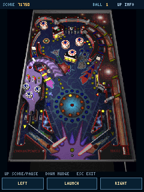
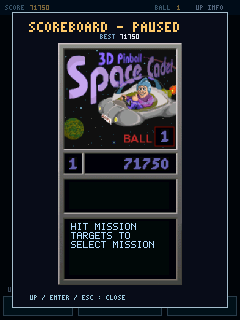

# 太空弹球 · BBK 9588

将经典 Windows《3D Pinball – Space Cadet》的开源引擎移植到 BBK 9588
（kj409588 / C200）。保留原版球台、碰撞、挡板、灯光、任务和音效，适配 240×320 竖屏。
详细计分板改为暂停弹窗，主画面留给球台。完整安装 ZIP 已包含原版游戏资源。

## 快速开始

预览版 `v0.1.1` 从 [GitHub Release](https://github.com/HelloClyde/BBK9588-SpaceCadetPinball/releases/tag/v0.1.1)
下载。选择 `SpaceCadet9588-0.1.1.zip` 完整安装包，已包含程序和全部原版资源。
同页的 `SHA256SUMS.txt` 可用于核对下载文件；单独的 `SpaceCadet9588.bda` 供已有资源时更新程序。
也可按下方命令自行构建，输出位于 `dist/`。

1. 解压完整安装 ZIP。
2. 将其中的 `应用` 目录复制到设备存储根目录，合并目录。
3. 从“娱乐天地”启动“太空弹球”。新局等约六秒游戏时间的送球动画结束后发球。

ZIP 内的安装目录如下，无需另外下载或制作资源：

```text
应用/程序/太空弹球.bda
应用/数据/游戏/Pinball/PINBALL.PAK
```

程序与资源作为两个文件随包提供。资源依次查找：

```text
B:\应用\数据\游戏\Pinball\
A:\应用\数据\游戏\Pinball\
A:\Pinball\
B:\Pinball\
```

最高分跟随实际加载资源目录保存为 `SCORE0.SAV` / `SCORE1.SAV`。
B 盘路径已实现；现有模拟器验证覆盖 A 盘，B 盘和真机运行尚待测试。

| 按键 / 触摸 | 功能 |
| --- | --- |
| 左 / 右 | 左右挡板，可同时按住 |
| 确认 | 按住蓄力，松开发球；结束后重开 |
| 上 / 触摸顶部 | 打开或关闭计分弹窗；弹窗期间暂停 |
| 下 | 撞台救球，频繁撞台触发 TILT |
| Esc | 关闭弹窗；球台画面抬起 Esc 后退出 |
| 底部触摸按钮 | 左挡板、发球、右挡板 |

### 从源码构建（Windows PowerShell）

在本仓库根目录运行，先安装 Git 和 Python 3.12 或更新版本：

```powershell
git clone https://github.com/HelloClyde/BBK9588-SpaceCadetPinball.git
cd BBK9588-SpaceCadetPinball
git submodule update --init --depth 1 -- sdk
.\sdk\scripts\setup_toolchain.ps1
.\build.ps1
python scripts/verify_checksums.py dist
```

构建直接校验并打包仓库内固定的 `assets/PINBALL.PAK`，不临时下载游戏资源。
不依赖 SDL、ImGui、Pillow 或 pefile。
已有工具链可用 `-Prefix '工具链目录/bin/mipsel-none-elf-'`，或设置
`BDA_TOOLCHAIN_PREFIX`。也可以分别运行 `python build_native.py` 和
`python package_release.py`。

### 资源来源与再生成（开发者可选）

正常使用和构建不需要此步骤。需要检查或再生成资源包时，可导入与清单匹配的原始文件：

```powershell
python import_original_data.py '原版资源目录'
python make_resource_pack.py
```

`original-data/PINBALL.PAK` 内有 66 个经过 SHA-256 校验的原始文件。
程序也支持散放 DAT/WAV 回退；PAK 可减少 NAND 文件打开次数。
也可运行 `python fetch_original_data.py`，从固定来源静态提取原始文件，再运行
`python make_resource_pack.py`。下载内容先校验整个 bundle，不执行下载脚本。
默认打包命令始终生成包含资源的完整安装包：

```powershell
python package_release.py
```

输出在被 Git 忽略的 `dist/`。仓库内归档的来源、哈希和再生成说明见
[assets/README.md](assets/README.md)；分发授权说明见 [SOURCE_NOTICE.md](SOURCE_NOTICE.md)。

## 截图

以下为本项目在完整 C200 固件模拟器中实际运行的截图，使用原版游戏资源。

| 竖屏球台与实际得分 | 暂停计分弹窗 |
| --- | --- |
|  |  |

## 依赖

| 用途 | 依赖 |
| --- | --- |
| 成品运行 | BBK 9588 / C200，240×320；完整 ZIP 已附游戏资源 |
| SDK | [bbk9588-bda-sdk](https://github.com/HelloClyde/bbk9588-bda-sdk)，固定 `f2fcbe020e7e94014c33d7e5c593802e4b1e3034` |
| BDA 构建 | Python ≥3.12；SDK 安装脚本提供的 `mipsel-none-elf` GCC 15.2.0，Windows 版 |
| 宿主验证（可选） | GCC/G++，本地验证使用 MinGW-w64 GCC 16.1.0；真实引擎测试另需原版数据 |
| 图标再提取（可选） | Pillow、pefile 与经哈希核验的 XP `PINBALL.EXE`；普通构建不需要 |
| 模拟器验证（可选） | 兼容的完整固件模拟器、其 Python 和自行准备的合法固件/NAND；不随仓库分发 |

引擎代码固定为上游 `cb9b7b886244a27773f66b0b19fdc2998392565e`，在 `native/engine/`
保留并适配。桌面 SDL/ImGui 平台入口不参与原生构建。原生版本使用 MIPS32 小端软件浮点、
原版软件深度渲染、PCM 混音和轻量 C/C++ 运行时。

SDK 的单个刷盘接口保留在应用内的 `native/sdk_compat.h`，使固定公开 SDK 足以重建；
无需本机 SDK 其他未提交改动。

## 验证与自动构建

```powershell
python native/test_file_cache.py --cc gcc
python native/verify_host.py --cxx g++
python verify_original_emulator.py --emulator-root '模拟器目录' --require-ball-ready --require-score --play-seconds 35
```

模拟器脚本检查指定端口并新建专用 NAND 副本，不操作用户已有镜像。
宿主和模拟器的完整引擎测试使用开发者导入的原版数据目录。
已有输入、触摸、暂停、计分存档、退出的运行证据见 [验证记录](docs/VERIFICATION.md)。
当前没有真机验证，也没有人工音效试听结果。

GitHub Actions 配置包含 main / PR / 手动构建与 `vMAJOR.MINOR.PATCH` 标签 Release。
CI 校验归档及包内全部 66 个原始资源，构建程序并验证完整 ZIP 的安装路径和校验表，
再运行缓存测试；CI 不宣称通过模拟器测试。
正式发布使用同次构建的 BDA、ZIP、`BUILDINFO.json` 和 `SHA256SUMS.txt`。
实际构建状态见 [Actions](https://github.com/HelloClyde/BBK9588-SpaceCadetPinball/actions)。
维护者已确认原版资源具有对应分发授权；第三方资源和原版图标不由本仓库重新许可为 MIT，详见来源声明。

## 感谢

- Andrey Muzychenko（k4zmu2a）与 [SpaceCadetPinball](https://github.com/k4zmu2a/SpaceCadetPinball) 贡献者：开源反编译引擎与原版行为复现。
- 原版 Space Cadet 的开发者与 Windows 移植作者：经典球台、美术、音效和玩法。
- [lrusso/3DPinballSpaceCadet](https://github.com/lrusso/3DPinballSpaceCadet)：先前测试资源的可核验来源。
- HelloClyde 与 [BBK 9588 Native BDA SDK](https://github.com/HelloClyde/bbk9588-bda-sdk) 贡献者：原生接口、构建与验证工具。

致谢不替代第三方许可。自有代码使用 MIT；SDK 兼容封装、上游引擎、原版图标和游戏
数据分别按 [来源声明](SOURCE_NOTICE.md) 说明，不统一套用同一许可证。
